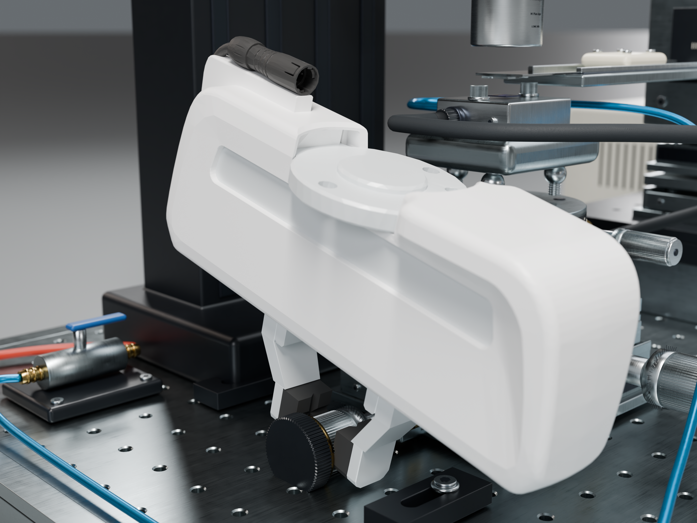

# Gripper contact benchmark



[Watch the measured 12-second contact task](contact_task.mp4) ([video provenance](video_report.json)).

A Panda parallel gripper closes on the transfer instrument's sample-X micrometer,
turns it −15°, releases, and retracts. The measured stage motion comes from
gripper/knob contacts; instrument actuators are removed. The wrist is a four-axis
Cartesian test fixture, not a complete robot arm. This benchmark runs in native
MuJoCo; the gallery does not yet provide a browser-live robot controller.

All three contact trials passed. The −20.833 µm stage target was reached within
0.029–0.131 µm, with no unintended robot/instrument contacts. Maximum native
contact penetration was 20.8 µm, and peak normal force per individual contact
was 0.146 N. Instrument actuator force and applied wrench stayed exactly zero.
Nine paired controls (disabled contact, missed grasp, and no turn) correctly
failed the task; maximum stage drift was 0.0068 µm. The portable package exactly
reproduced the native seed-0 contact and control results.

Download and extract [the portable benchmark](portable.tar.gz), then run:

```sh
tar -xzf portable.tar.gz
cd transfer-gripper-benchmark
python -m venv .venv
. .venv/bin/activate
python -m pip install -r requirements.txt
python robotics/validate_gripper.py --out validation/robotics
python robotics/view_gripper.py --autoplay
```

The viewer needs a desktop OpenGL display. A/D, S/W and F/R move the wrist in
X/Y/Z; Q/E roll; O/C open/close; Space toggles playback; Backspace resets.
The portable native viewer runs physics and shows instrument contact proxies
with Panda visual meshes. [The articulated GLB](model.glb) is separate geometry
for the detailed robot + instrument; it contains no physics or baked animation.
Playback code must apply the measured trajectory to its named body hierarchy,
including the instrument's visual service-line deformation.

Evidence: [12-condition summary](validation/summary.json),
[portable verification](validation/portable_verification.json),
[measured 50 Hz trajectory](trajectory.json), and
[render provenance](render_report.json). Three additional swept visual-mesh
audits checked both hoses against the actual gripper meshes at every recorded
frame; worst conservative clearance was 10.13 mm.

Instrument inertia/friction and gripper contact friction are estimates, not
measured calibration. Hoses have visual bending but no load/contact physics.
The initial gripper pose is already above the knob; larger rotations need
regrasp planning. This validates one precision contact task, not every possible
robot/instrument interaction.

Panda geometry and hand/finger inertials are from MuJoCo Menagerie commit
`eea4c7431b63da8278b0ff31638e0b0e941cec0e`, under
[Apache 2.0](PANDA_LICENSE). [Source fingerprints](PANDA_SOURCE.json) are included.
The Cartesian fixture, servo settings, and PBR finish are benchmark estimates.
